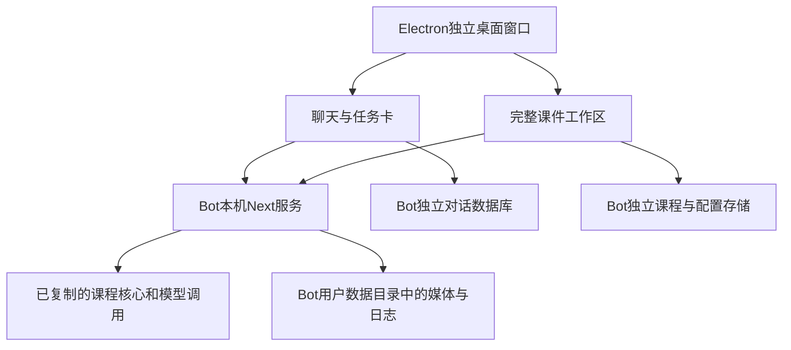

# 灵境课堂 Bot：独立桌面项目说明

项目：`/Users/sy/ljkt-bot`；当前测试版本：0.2.0。拟产品主体：黑龙江波安特教育科技有限公司。

## 当前已经实现

新项目拥有独立的Electron桌面窗口、本机服务、源代码与依赖、对话数据库和应用数据目录。原灵境课堂 `/Users/sy/OpenMAIC` 不参与新应用的源码或依赖加载，也不会收到Bot修改的自动回写。

界面参考Grok一类聊天应用：左侧管理对话和课件，中间呈现聊天、数学公式和任务卡，需要制作或编辑时展开右侧完整课件工作区。幻彩Logo和现有课程能力继续使用。

聊天复用现有文本模型配置、模型授权与统一调用封装，支持流式回复、停止、错误保留和本机对话恢复。上传的材料先独立保存，制作时交给现有解析流程；Bot不会把仅知道文件名表述为已经阅读正文。聊天记录不保存模型API密钥。

课程制作任务由对话整理要求并生成可操作任务卡；老师点击后进入原有完整的大纲审阅与课程制作流程。实际课件仍可在专业模式中继续编辑。教师计划、学生笔记和导出基于保存的课件执行，任务卡不代表这些操作已经完成。

## 实际架构

桌面主进程管理单实例、独立服务启动、端口检查、下载保存、菜单和退出。网页不获得Node.js或任意文件系统权限，现有互动页面继续使用原有沙箱。桌面服务从应用包里的课件核心启动，不要求终端手动启动原系统。

## 功能保留

教师工作台、制作和优化课件、大纲审阅、课堂角色与音色头像、普通页、互动模拟、测验和PBL全部保留源码与入口。专业模式保留页面编辑、HTML与布局、讲稿动作及音频编辑；授课保留导航、字幕、倍速和白板。

课程资料保留教师计划和学生笔记、编辑保存、版本与恢复、Word及PDF打印。课件保留PPTX、包含旁白和视频的HTML、不含旁白的HTML、大文件ZIP回退，以及离线播放器画笔批注。可选视频渲染仍需要相应服务配置，没有把服务缺失包装为可以直接输出视频。

原来关闭的智能体工作台和技能管理界面没有在原系统重新启用。Bot使用新增的独立聊天入口，不要求外置PostgreSQL才能聊天。真实教材知识库、学生账号和外部平台机器人不属于本次实现范围。

逐项代码位置见 `docs/功能保留清单.md`。

## 隔离和数据

开发端口3010，浏览器测试端口3012，桌面端口30310。桌面端拒绝占用原系统的3000和3002端口，不停止其他进程，不附着未知服务。浏览器来源固定，保证每次打开可以读取自己的课件。

macOS用户数据位于 `~/Library/Application Support/LingjingClassroomBot/`。该目录保存独立浏览器资料、课程、媒体、对话和日志。新项目没有复制原系统的`.env.local`、API密钥、实际课程数据库、Git历史或构建缓存；独立依赖和构建已在新项目中完成。

以后如果启用服务端数据库或对象存储，应给Bot使用单独的数据空间。已有课程通过原功能的导出／导入迁移，不能让两个项目共写同一份本机课程目录。

## 本次验证和交付

已完成类型检查、Bot单元测试、课程资料和播放器等回归、真实浏览器入口与恢复测试，以及打包应用实际启动和完整工作台加载自检。详细证据与测试边界见 `docs/本次构建与验证.md`。没有使用原有密钥运行真实付费模型课程生成；首次试用需要自行配置模型。

交付本机macOS ARM64测试应用，不将其称为正式签名发行版。后续可依据试用反馈完善聊天直接编辑工具、后台任务持久化、自动更新与平台安装程序。应用最小化或关闭窗口时保留运行；从菜单退出或系统关闭后不承诺未完成任务在后台继续。

原始许可证保持不变。以后接入原项目更新时，仅在Bot副本中比较、测试并采用，不建立自动双向同步。

技术依据：[Electron进程模型](https://www.electronjs.org/docs/latest/tutorial/process-model)、[Electron上下文隔离](https://www.electronjs.org/docs/latest/tutorial/context-isolation)。
